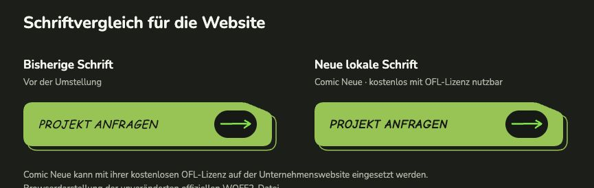
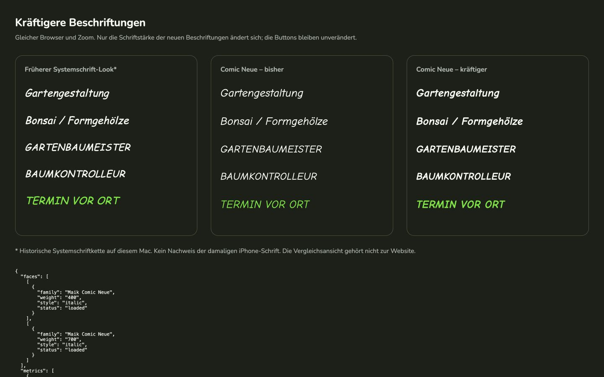
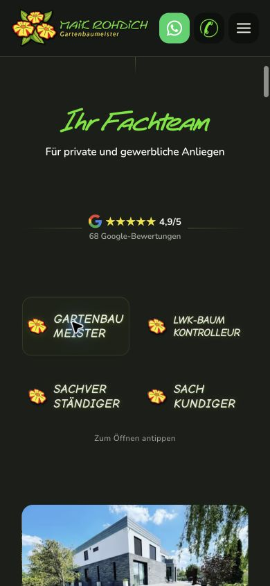
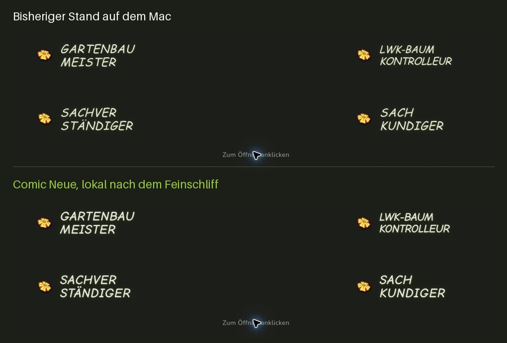

# Abschließende Schriftprüfung – 09.10.2026

**Einordnung: Für das Deployment vorbereitet.** Die lokale Schriftlösung ist erneut
geprüft; es wurde kein Fehler gefunden, der eine Änderung an Fonts, CSS oder Layout
verlangt. Die tatsächliche Schrift einzelner Website-/Widget-Textstellen im nativen
Schriftinspektor, ein vollständiger Netzwerk-Mitschnitt mit deaktiviertem Cache und
echte iPhone-/Pixel-Prüfungen fehlen noch. Deshalb ist dies keine pauschale
Veröffentlichungsfreigabe. Die spätere HTTPS-Produktionsdomain wurde nicht geprüft.

Diese Prüfung ersetzt für den aktuellen Stand die nachfolgenden älteren Befunde;
sie bleiben vollständig als historische Dokumentation erhalten. **B = belegt**,
**E = Einschätzung**, **O = noch offen / technische Prüfgrenze**.

## Aktueller Stand und erhaltene Änderungen

**B:** Branch `codex/homepage-review`, HEAD
`651f2355b383d5d66862ab5b4e5192549f50f29f`. Vorhandene Änderungen, Löschungen,
untracked und ignored Dateien wurden vor der Prüfung vollständig gesichert:
`/Users/davidk./Documents/SD-MR-001/maik-font-final-20261009-qzair3iq`.
Die private Sicherung enthält Worktree-Tar, Inhaltsmanifest, Status, HEAD und beide
Diffs; sie gehört nicht zur Website-Auslieferung. Der vollständige Generatorbuild
lief in einer getrennten Kopie des **aktuellen** Worktrees, nicht in einem alten
Commit. Im Original wurden ausschließlich dieser Bericht, `ASSETS.md`, das
bestehende Nachweis-JSON und neue Prüfbelege ergänzt. Keine Schriftdatei, CSS-,
HTML-, JavaScript-, Generator-, Logo- oder Widget-Datei wurde bei dieser Prüfung
verändert. Der abschließende Inhaltsabgleich bestätigt 5.217 unveränderte
Bestandseinträge und genau drei ergänzte Dokumentationsdateien; keine vorhandene
Datei fehlt. [Erhaltungsnachweis](schriftarten-20261009-abschluss/preservation.json). Kein Commit, Push, Deployment oder Umschreiben der Git-Historie.

## Inventar der lokalen Schriften

| Familie | Mitgelieferte WOFF2-Dateien unter `assets/fonts/` | Eingebundene Schnitte und aktueller Einsatz |
| --- | --- | --- |
| Nunito, Version 3.602 | `nunito-latin.woff2`, `nunito-italic-latin.woff2` | normal und echter italic, variable Gewichte 200–1000; Website-, Header- und Fließtext. Italic ist verfügbar; nicht jeder registrierte Schnitt wird auf jeder Seite angefordert. |
| Baloo 2, Version 1.700 | `baloo2-variable-latin.woff2`, `baloo2-700-latin.woff2` | normal; variable Datei enthält 400–800, bestehende CSS-Zuordnung bleibt 400–600; separate echte 700-Datei. Bewusst gewählte Überschriften und andere Baloo-Texte bleiben Baloo. |
| Maik Comic Neue, Version 2.003 | `comic-neue-italic-400.woff2`, `comic-neue-italic-700.woff2` | echte italic 400 und 700; aktuelle erfasste Handschrifttexte fordern 700. Der 400er Originalschnitt der ersten Umstellung bleibt registriert und mitgeliefert, wurde in den aktuellen Website-Stichproben jedoch nicht verwendet. |

**B:** Alle sechs Dateien enthalten `ä ö ü Ä Ö Ü ß ²`. Familiennamen, Achsen,
Gewichte, Stilmetadaten, Copyright und SHA-256 wurden direkt aus den Dateien
geprüft. Alle 19 `@font-face`-Definitionen und 56 Font-Preloads haben passende
lokale Pfade; die Definitionen verwenden `font-display: swap` und kein `local()`.
Comic Neue hat genau zwei gemeinsame Definitionen in `styles.css`, ausschließlich
mit eigenen Datei-URLs. Die erforderlichen Kursivschnitte stammen aus Originalfonts;
es wurden keine Betriebssystemfonts kopiert oder konvertiert.

**B:** 30 aktive Handschriftdeklarationen in elf CSS-Dateien verwenden ausschließlich
`"Maik Comic Neue", cursive`. Gemeinsame Komponenten, Vorlagen und Generatorquellen
sind eingeschlossen. Ein zusätzlicher Scan von 191 öffentlichen Quelldateien und
der erzeugten Dateien findet keine aktive Comic-Sans-/Chalkboard-Bevorzugung,
Inter-/Outfit-Einbindung, alte SVG-Schriftgruppe oder externe eigene Font-Quelle.
Die Erwähnung von Outfit im Generatorhilfsmodul `legacy-fonts.mjs` ist die gezielte
**Entfernungsregel** für alte SVG-Gruppen, keine Schriftverwendung. Historische
Dokumentation und die ursprüngliche Git-Historie enthalten weiterhin alte Namen
und Dateien; sie wurden nicht umgeschrieben.

Weitere bewusste Schriftregeln sind generische Fallbacks und `Georgia, serif` für
ein dekoratives Anführungszeichen-Pseudoelement in der früheren Review-Komponente
(`privat-form.css`). Sie sind keine bisherige Handschrift. „Das Team“ auf Über uns
fordert bereits bestehendes Baloo 2 italic 700 an: Baloo hat hier nur normale
Dateien, daher ist diese Kursivdarstellung synthetisch; sie wurde nicht durch Comic
Neue ersetzt. Für **Comic Neue** werden hingegen die echten italic-Dateien benutzt.

Dateiinventar einschließlich jeder Prüfsumme, Lizenzzuordnung und Einbindung:
[font-inventory.json](schriftarten-20261009-abschluss/font-inventory.json).
Aktive Deklarationen/Quelldateien:
[source-scan.json](schriftarten-20261009-abschluss/source-scan.json).

## Herkunft und Lizenz – erneut geprüft

**B:** Für jede Familie liegt der vollständige passende OFL-1.1-Text mit Copyright
unter `assets/fonts/` vor: `nunito-OFL.txt`, `baloo2-OFL.txt`,
`comic-neue-OFL.txt`. Alle drei wurden mit den offiziellen Lizenztexten erneut
verglichen und sind bytegleich. Die Copyright-Zeilen stimmen mit den tatsächlichen
Fontdateien überein: Nunito Project Authors (2014), Baloo 2 Project Authors (2019)
und Comic Neue Project Authors (2014). **Kommerzielle Unternehmenswebsite und
Self-Hosting sind für alle drei erlaubt.** Copyright und vollständige OFL müssen
mit den Fontdateien erhalten bleiben; die Fonts bleiben unter OFL, dürfen nicht
allein verkauft werden und Änderungen müssen gegebenenfalls reservierte Namen
beachten. Bei dieser Prüfung wurden keine Fonts verändert. Die Website-Texte und
Bilder werden durch die OFL nicht automatisch unter dieselbe Lizenz gestellt.
Quelle: [offizielle OFL-FAQ, insbesondere Webfont-Nutzung](https://openfontlicense.org/ofl-faq/).

Comic Neue wurde erneut direkt gegen Commit
`ef5be72411141d01f0b865df8edb47e552c11c3c` des
[Originalprojekts](https://github.com/crozynski/comicneue) geprüft:
beide WOFF2-Dateien und OFL sind bytegleich. Exakte URLs, erste Abrufzeit,
Dateinamen und Hashes stehen im
[Herkunftsmanifest](../assets/fonts/comic-neue-provenance.json).

Für Nunito und Baloo 2 sind die Familienquelle, Version, Copyright, Lizenz und
lokalen Hashes dokumentiert. **Dokumentationsgrenze:** Die ursprünglichen genauen
Download-URLs wurden im Projekt nicht aufbewahrt; die früher in `ASSETS.md`
genannten Abrufdaten sind historische Angaben, keine nachträglich bewiesenen
Download-Belege. Die am 09.10.2026 erneut von den offiziellen Google-Fonts-Endpunkten
bezogenen Referenzen haben dieselben Versionen, Metadaten, Zeichen, Metriken,
Achsen und Glyphenkonturen. Ihre Bytes unterscheiden sich in `head`/`prep`; beim
statischen Baloo auch in der Glyphen-Codierung, bei identischen Konturkoordinaten.
Daher werden sie ausdrücklich als **aktuelle Vergleichsquellen**, nicht als
byteidentische historische Originaldownloads dokumentiert. Das ist kein
festgestelltes Lizenzproblem. Die bestehenden Fonts bleiben unverändert.

Quellen, Abrufdatum, Hashes und Tabellenvergleich:
[official-source-check.json](schriftarten-20261009-abschluss/official-source-check.json),
[source-table-comparison.json](schriftarten-20261009-abschluss/source-table-comparison.json).
Die dortigen Google-Fonts-URLs wurden zur Herkunftsprüfung vom Prüfwerkzeug
angefragt; sie sind **keine Website-Einbindung** und kein beobachteter Besucheraufruf.

## Build, Auslieferung und Browserdarstellung

**B:** Font-Check im Original und im erzeugten Build bestanden. Vollständiger Build
mit Node 24.19.0 zweimal bestanden; der zweite Lauf erzeugt keine weiteren
Byteänderungen. Alle sechs WOFF2-Dateien, drei Lizenztexte und das Comic-Neue-
Herkunftsmanifest sind bytegleich im Build enthalten. Über den vorhandenen
Vorschau-Server antworten alle zehn Pfade mit HTTP 200 und passenden MIME-Typen;
Fontbytes/Hashes stimmen mit dem Build überein. `Cache-Control: no-store` ist gesetzt.
Unabhängige bestehende Buildwarnungen zu vier nicht abgeleiteten Galeriebildern und
fehlenden Gewerbe-Submenu-Markern haben keinen Schriftbezug und wurden nicht verändert.

**B:** Chrome 154 auf einem **echten Mac**, macOS 26.5.1 (25F80), geprüft.
Homepage, Über uns, Galerie sowie Baumkontrolle und Vermessung/Lasertechnik bei
320 × 760, 390 × 844, 844 × 390, 901 × 720, 1024 × 800, 1440 × 960 und
1920 × 1080 px: 35 Seiten-/Fensterkombinationen, 560 erfasste Handschrifttextstellen,
alle italic 700. Kein horizontaler **Seiten**überlauf oder Abschneiden nach der
DOM-/Bereichsmessung. Das ist kein vollständiger Pixelnachweis aller schmalen
Darstellungen: die bereits dokumentierten inneren Qualifikationsüberhänge bei
320 px sind weiterhin sichtbar erlaubt. Tatsächliche Mac-Aufnahmen der
Qualifikationen und des fertig eingeblendeten Über-uns-Zitats sind beigefügt.
Die sechs sichtbaren animierten Zitat-Spans wurden gesondert geprüft; damit ist
nicht nur das unsichtbare Screenreader-Exemplar erfasst.

Der fokussierte „Projekt anfragen“-Text bleibt Comic Neue italic 700 / 18,24 px;
`focus-visible` ist aktiv. Die statische Zustandsprüfung findet keine zusätzlichen
Font-, Größen- oder Laufweitenregeln in Hover-/Fokus-/Aktivselektoren. **O:** Ein
vollständiger dynamischer Hoverdurchlauf wurde nicht durchgeführt. In dieser
Abschlussprüfung wurden Schriftgrößen, Spacings und Layout nicht erneut angepasst;
der zuvor akzeptierte optische Feinschliff bleibt unverändert. Die weiter unten
aufgeführten historischen Vorher-/Nachher-Vergleiche wurden nicht als neue
Vergleichsläufe ausgegeben.

**B, mit klarer Grenze:** Eine separate temporäre Testansicht lädt die sechs
**konkreten eigenen** Dateien mit nicht null Transfergröße. Für Comic Neue 400/700
stimmen die Canvas-Textbreiten einschließlich Sonderzeichen exakt mit den direkt
aus den Fontdateien berechneten Glyphenfortschritten überein; ein generischer
Fallback hat deutlich andere Breiten. Die anderen vier Proben unterscheiden sich
bei 32 px um weniger als 0,12 px, vereinbar mit variabler Interpolation/Rundung.
Dies ergänzt den Lade- und Dateinachweis über bloßes `font-family` hinaus,
**ersetzt aber keine native Prüfung der Glyphen jeder Website- oder Widget-Textstelle**.
Die Testansicht/der Testserver werden nicht in Produktionsseiten eingebunden.

**O:** Der native Schriftinspektor war über Computer Use nicht zugänglich, weil die
macOS-Zugriffsfreigaben für Bedienung/Bildschirminhalt noch ausstanden. Es wurde
kein frischer isolierter Browserkontext mit deaktiviertem Cache erstellt. Ein neuer
Tab und `no-store` für eigene Dateien deaktivieren nicht den Drittanbieter-Cache.
Echtes Safari, iPhone und Pixel/Android wurden in diesem Lauf nicht geprüft;
mobile Fenstergrößen sind ausdrücklich Mac-Browserprüfungen.

Belege: [Build](schriftarten-20261009-abschluss/build-results.json),
[HTTP](schriftarten-20261009-abschluss/http-check.json),
[Browsermatrix](schriftarten-20261009-abschluss/browser-current.json),
[Fontdatei-/Renderprobe](schriftarten-20261009-abschluss/browser-file-proof.json),
[Fokus](schriftarten-20261009-abschluss/focus.json),
[Zustandsregeln](schriftarten-20261009-abschluss/state-rules.json),
[sichtbares Zitat](schriftarten-20261009-abschluss/quote.json).

## Elfsight – aktueller veröffentlichter Widgetzustand

**B:** Auf der Homepage geladenes Widget **v3.53.0**; geprüft als Desktop-Widget,
geöffnetes Desktop-Bewertungspopup sowie Widget/Popup bei 390 × 844 px. Die
Auswertung berücksichtigt die Shadow-DOM-Wurzeln des Widgets und des Popups.
Die Reviewtexte deklarieren Nunito normal 400/600/700, auch im geöffneten Popup.
Der mobile Herstellerlink „Free Google Reviews Widget“ deklariert dagegen
`Roboto, Arial, sans-serif` 600. Das betrifft die Elfsight-Werbekennzeichnung;
eine dafür geladene Roboto-Datei wurde nicht beobachtet. Die tatsächlich dafür
verwendete Fallbackschrift wurde nicht mit dem Schriftinspektor festgestellt.

Beobachtete Auslöser/URLs sind der Einbettungsloader
`https://elfsightcdn.com/platform.js`, Widget-Boot
`https://core.service.elfsight.com/p/boot/?w=d265013d-d9f3-4b6b-8ab8-d050171ce838`
und das veröffentlichte Reviewmodul
`https://universe-static.elfsightcdn.com/app-releases/google-reviews/stable/v3.53.0/7efd9184817592fe6e8cf2f859dc9365f208b966/widget/googleReviews.js`.
Dies sind Skript-/Widgetaufrufe, keine Fontdateien. Eigene beobachtete Fontaufrufe
stammen nur vom Vorschau-Server. In den vier Widgetzuständen wurden **keine externen
Font-Dateien oder Font-Stylesheets beobachtet**, insbesondere keine Google-Fonts-
Aufrufe. Es wurde kein eigener Font-Override oder Netzwerkblock hinzugefügt und
keine Elfsight-Einstellung verändert.

**E:** Das deklarierte Nunito passt zur vom Nutzer gesetzten Einstellung
„Default / Apply from Website“. Laut
[Herstellerdokumentation](https://help.elfsight.com/article/1817-how-fonts-work-in-elfsight-widgets)
übernimmt Default die Schrift der Einbettungsumgebung. **O:** Ressourceninventar,
CSS-Liste und Fontdatei-Test beweisen weder die konkrete Glyphenschrift der
Widgettexte noch die vollständige Entfernung jedes externen Aufrufs in einem
ungecachten Kontext. Ein vollständiger HAR einschließlich fehlgeschlagener
Requests und ihrer Initiatoren fehlt. Kein behaupteter endgültiger Google-Fonts-
Entfernungsnachweis. Die Beobachtung betrifft den veröffentlichten Widget-Code
in der lokalen Website, nicht eine Hetzner-Produktionsdomain.

Nachweis aller vier Zustände:
[elfsight-states.json](schriftarten-20261009-abschluss/elfsight-states.json)
und [Desktop-Popup](schriftarten-20261009-abschluss/elfsight-desktop-popup.jpg).

## Schriftgrafiken sind separate Bildassets

**B:** Logos, Garten-Schriftgrafik, Alphabetbilder und Balkonkasten-Schriftgrafik
bleiben bytegleich. 21 relevante Bilddateien wurden inventarisiert. `ASSETS.md`
dokumentiert den vom Auftraggeber gelieferten Garten-Schriftzug sowie mechanische
Logo-/Blütenableitungen. Die Alphabetbilder **F und O** sind als gelieferte Dateien
in AP-330 dokumentiert. AP-565 dokumentiert die technischen Ableitungen der
Balkonkasten-Grafik. Das bestätigt die dokumentierte Lieferung/Bearbeitung, nicht
automatisch Urheberschaft oder ausdrückliche Nutzungsrechte aller Ausgangsgrafiken.

**Fehlende Dokumentation, kein nachgewiesener Rechtsverstoß:** Für das Originallogo,
die übrigen 14 Alphabet-PNGs und das Balkonkasten-Ausgangsmotiv wurde keine konkrete
Urheber-/Website-Nutzungsbestätigung gefunden. Die drei OFL-Lizenzen belegen
**keine Rechte an diesen eigenständigen Bildern**. Auftraggeber oder ursprünglicher
Gestalter sollte die Herkunft und Website-Nutzungsrechte bestätigen; der
Projektverantwortliche legt diese Bestätigung vor Veröffentlichung in der
Asset-Dokumentation ab. Das ist eine getrennte Bildasset-Aufgabe, kein
festgestellter Lizenzfehler der lokal eingebundenen Fonts.
[Grafikinventar mit Hashes](schriftarten-20261009-abschluss/graphic-inventory.json).

## Wenige verbleibende Prüfungen

1. **Entwickler, vor Veröffentlichung lokal möglich; unter HTTPS nach Deployment
   wiederholen:** In einem frischen Chrome-Kontext DevTools öffnen, unter Network
   „Disable cache“ aktivieren, neu laden, bis Elfsight scrollen und „Mehr lesen“
   öffnen. Requests einschließlich fehlgeschlagener Einträge/Initiator als HAR
   dokumentieren. Auf `.woff`, `.woff2`, `.ttf`, `fonts.googleapis.com`,
   `fonts.gstatic.com` und sonstige Font-CDNs prüfen. Bei eigenen Buttons und
   Nicht-Button-Handschrift in Elements → Computed → Rendered Fonts den Webfont
   **Comic Neue Bold Italic** prüfen; bei Review-/Popuptexten die tatsächliche
   **Nunito**. Die CSS-Familienliste allein zählt nicht. Externe Treffer müssen mit
   URL, Initiator und Website-/Drittanbieterzuordnung dokumentiert werden.
2. **Nutzer mit iPhone 16 Pro/Safari und Pixel/Chrome, möglichst vor Veröffentlichung;
   nach Deployment dieselben Seiten wiederholen:** Beide Geräte im selben WLAN
   wie der Mac öffnen aktuell
   `http://192.168.1.191:8080/?fontcheck=20261009final`.
   Die IP ist der Stand dieses Prüflaufs und kann sich ändern. Homepage, Über uns,
   Galerie, Baumkontrolle und Vermessung/Lasertechnik hochkant/quer kontrollieren:
   Buttonzentrierung, lange Beschriftungen, Qualifikationen und Zitat, Umbrüche,
   abgeschnittene Zeichen und Seitenüberlauf. Prüfen nach vollständig geladenen
   Fonts und Einblendanimationen. Ein bloßer direkter Font-Download beweist den
   gerenderten Text nicht. Entwickler kann das iPhone per USB mit Safari-
   Webinspektor am Mac prüfen (Webinspektor am iPhone und Entwicklerfunktionen am
   Mac aktivieren); Pixel per USB-Debugging mit Chrome `chrome://inspect` und
   anschließend „Rendered Fonts“. Eigene Texte sollen Comic Neue Bold Italic,
   Fließtexte Nunito/Baloo entsprechend dem Inventar verwenden. Sonderzeichen
   `äöüÄÖÜß²` in der lokalen Testprobe beziehungsweise passenden vorhandenen Texten
   auf Fallback prüfen.
3. **Nach Deployment, Entwickler:** Produktions-HTML/CSS und alle sechs WOFF2-
   sowie drei OFL-Pfade frisch laden; HTTP-Status, MIME, Hash, Cache/CORS und
   tatsächliche Rendering-/Widgetrequests unter der endgültigen HTTPS-Domain
   prüfen. Geänderter Serverursprung und Drittanbieterzustand lassen sich nicht
   durch erfolgreiche lokale Builds vorweg bestätigen.

Die getrennte Herkunftsbestätigung der Bildgrafiken steht oben; sie ist keine
zusätzliche technische Fontänderung. **Die lokale Umstellung ist fertig. Das Thema
Schriftarten und Einbindung kann nach den genannten Render-/Netzwerk- und echten
Gerätekontrollen sowie der Prüfung unter der Produktionsdomain abgeschlossen werden.**

---

Die nachfolgenden Umstellungs-, Vergleichs- und Altbestandsberichte sind historische
Prüfstände. „Aktuell“ innerhalb dieser älteren Abschnitte bezieht sich jeweils auf
das dort genannte Datum; der Abschlussstand steht ausschließlich oben.

# Umstellung und frühere Prüfstände – 08.–09.10.2026

Alle zuvor mit `"Comic Sans MS", "Comic Sans", "Chalkboard SE", cursive` gesetzten
Handschrifttexte verwenden jetzt `"Maik Comic Neue", cursive`.
Nunito und Baloo 2 bleiben unverändert. Die nachfolgende frühere Bestandsprüfung
ist vollständig erhalten und als **historischer Stand vor dieser Umstellung** gekennzeichnet.
Die dortige Entscheidung „Handschrift bis zur Auswahl belassen“ wurde durch die
jetzige ausdrückliche Auswahl von Comic Neue abgelöst.

**B = belegt**, **E = optische Einschätzung**, **O = offen / technisch nicht geprüft**.
Die vom Nutzer gemeldete Safari-Inspektor-Beobachtung am bisherigen Button
(Comic Sans MS, Gewicht 400, angefordertes italic) ist ein vom Nutzer gelieferter
Nachweis. Die vorherige tatsächliche iPhone-Schrift wurde weiterhin nicht bestätigt.

## Sicherung und Umfang

**B:** Branch `codex/homepage-review`, Ausgangs-HEAD
`651f2355b383d5d66862ab5b4e5192549f50f29f`. Vor Beginn dieser Umstellung bestanden
104 Git-Status-Einträge. Vollständige private Sicherung des aktuellen Worktrees,
einschließlich ignored/untracked Dateien, und der gemeinsamen Git-Datenbank:
`/Users/davidk./Documents/SD-MR-001/maik-comicneue-20261008-lhhgp7o4`.
Dort liegen `worktree-before.tar`, `git-common-before.tar`, `all-refs-before.bundle`,
Status, Patches, Referenzen und Inhaltsmanifest. Die Sicherung enthält private
Projektdateien und wird nicht über die Website veröffentlicht.
Kein Reset, kein Commit, keine Historienumschreibung, kein Push und kein Deployment.

30 bisherige Handschriftdeklarationen in elf CSS-Dateien wurden erfasst.
CSS-Regeln und wirksame Vererbung ergaben italic 400 und italic 700;
700 war unter anderem an den „Für wen“-Überschriften auf „Über uns“ geerbt.
Normale Schnitte waren für diese Umstellung nicht erforderlich.
Inventar: [bisherige Regeln](schriftarten-20261008-comic-neue/handwriting-rules-before.json).
Vorher-/Nachher-DOM-Messungen und weitere Vorschauaufnahmen liegen in der privaten Sicherung.

## Herkunft, Dateien und Lizenz

**B:** Unveränderte Original-WOFF2-Dateien aus
[Comic Neue, offizielles Projekt](https://github.com/crozynski/comicneue),
Commit `ef5be72411141d01f0b865df8edb47e552c11c3c`, Abruf 08.10.2026.
Version beider Dateien: `2.003;hotconv 1.0.109;makeotfexe 2.5.65596`.
Keine Konvertierung, kein Subsetting, keine eigenen Schnitte oder geänderten Glyphen.
Die zuvor zusätzlich heruntergeladenen offiziellen Google-Fonts-TTF-Dateien wurden
nicht in die Website übernommen: das Originalprojekt bietet passende WOFF2 direkt an.

| Datei unter `assets/fonts/` | Schnitt | SHA-256 |
| --- | --- | --- |
| `comic-neue-italic-400.woff2` | italic 400 | `09ab514b68ef3ddb55e03a7ec5a6b100caea5b36195a6d3f104250e3279efc65` |
| `comic-neue-italic-700.woff2` | italic 700 | `b24900d4debe9a84621dac335edaf7a87144e00c04cedb83602f654b01daa0c5` |
| `comic-neue-OFL.txt` | vollständige OFL 1.1 und Copyright | `7c38a22e5878e60fe423360553e63dd7be23d29f1f60336034935dbfc96e8320` |

Exakte unveränderliche Download-URLs, Größen und Dateizuordnung:
[Herkunftsmanifest](../assets/fonts/comic-neue-provenance.json).
[Mitgelieferte Lizenz](../assets/fonts/comic-neue-OFL.txt):
Copyright 2014 The Comic Neue Project Authors (https://github.com/crozynski/comicneue).
Die Copyright-Angabe in beiden Fonts stimmt mit diesem Lizenztext überein.
Kommerzielles Self-Hosting ist unter der OFL erlaubt; kein Fontkauf nötig.
Copyright/OFL müssen bei Weitergabe der Fonts erhalten bleiben, die Fontdateien dürfen
nicht für sich allein verkauft werden. „Kostenlos nutzbar“ heißt hier **unter OFL lizenziert**.

Gemeinsame Definition in `assets/css/styles.css`: zwei `@font-face`-Regeln für
`"Maik Comic Neue"`, italic 400 und 700, `font-display: swap`, eigene relative WOFF2-URLs.
Kein `local()`, kein externer Fontdienst und kein kopierter Betriebssystemfont.

## Behutsame optische Anpassung

**E, durch echte Browsermessungen gestützt:** Comic Neue hat kleinere Versalien und
regelmäßigere Formen. Für die Buttons kommt der echte Bold-Italic-Schnitt näher an
den bisherigen wahrgenommenen Strich des 400er Systemfonts heran.
Zwei gemeinsame Größenfaktoren in `styles.css` steuern die Anpassung:
`--type-handwriting-cta-scale: 1.14` und `--type-handwriting-title-scale: 1.08`.
`--type-cta-label-weight` ist nun 700. Größenregeln der betreffenden Labels, einschließlich
bestehender Breakpoints, verwenden diese Faktoren. Qualifikations-, Leistungs- und
Schrittbeschriftungen waren bei der ersten Umstellung 400 kursiv; die unten
beschriebene Nachschärfung stellt diese ebenfalls auf echtes 700 kursiv um. Schon
vorher 700 gesetzte Über-uns-Texte behielten bei der ersten Umstellung ihre Größe;
der unten dokumentierte Feinschliff vom 09.10.2026 ergänzt ihre Größenkorrektur. Nunito-/Baloo-2-Textgrößen bleiben unverändert.
Zeilenhöhen, bestehende Zeichenabstände, Farben, Großschreibung, Buttonformen,
Ausrichtung und Animationen bleiben erhalten. Keine neue Schrägstellung, Verzerrung
oder Änderung an globalen `font-synthesis`-Regeln.

Im selben Mac-Chrome-Browser, 1024 × 900 px, identische 362 × 64 px Buttonform:
„Projekt anfragen“ maß vorher 173,16 px Textbreite bei 16 px Schriftgröße und 22 px
Textzeilenbox; mit Comic Neue italic 700 / 18,24 px sind es 172,01 px und 21 px.
Der bestehende Zeichenabstand des Vorbilds bleibt je Beschriftungsregel .018–.025 em.
Das ist eine nahe Annäherung, keine identische Schrift: Comic Neue bleibt regelmäßiger,
weniger eigenwillig. Die anfänglich feineren 400er Beschriftungen wurden in der
unten beschriebenen Nachschärfung durch Bold Italic ersetzt.



Der Vergleich zeigt echte Browserdarstellung der verwendeten Originaldatei in einer
separaten Testansicht; kein generiertes Vergleichsbild. Er ist kein Nachweis für alle
Layoutzustände der Produktionsseiten. Die isolierte Testansicht bleibt außerhalb des Websiteprojekts.

## Nachschärfung: kräftigere Leistungen und Qualifikationen – 08.10.2026

Der Nutzer hat die Buttontexte ausdrücklich bestätigt, die übrigen Beschriftungen
jedoch als zu dünn empfunden. **B:** Diese verwendeten noch Regular Italic 400,
während die Buttons bereits Bold Italic 700 verwendeten. **E:** Der direkte
Browservergleich mit den historischen Systemschriftbeispielen auf demselben Mac
zeigt, dass echtes Comic Neue Bold Italic bei den vorhandenen Größen der früheren
wahrgenommenen Strichstärke deutlich näherkommt. Die Schriftformen bleiben verschieden.

**Aktuell:** Leistungsnamen einschließlich Sturmnotdienst, die vier
Qualifikationsbeschriftungen und die fünf Schrittüberschriften verwenden **italic 700**.
Fünf CSS-Regelblöcke in `home-dark.css`, `home-process.css` und `privat-form.css`
nutzen den gemeinsamen Wert `--type-handwriting-title-weight: 700` in `styles.css`.
Buttonregeln, Schriftgrößen, Zeichenabstände, Zeilenhöhen, Farben und Layoutregeln
wurden dabei nicht verändert. Die bestehenden echten Originalfonts und ihre
Lizenznachweise bleiben bytegleich. Es wird keine künstliche Verdickung eingesetzt.

Nur die vier geänderten CSS-Dateien erhalten Cache-Version `20261008cn2` in
bestehenden HTML-Einbindungen und den zugehörigen drei Generator-Konstanten.
Die übrigen CSS-Versionen bleiben beim Stand der ersten Umstellung.

**B:** Homepage vor/nach der Änderung bei zehn bisherigen Fenstergrößen geprüft;
Über uns, Galerie und Baumkontrolle zusätzlich bei 390 × 844, 844 × 390 und
1440 × 960 px (insgesamt 19 Kombinationen nach der Änderung). Berechnete
Schriftregeln sämtlicher 60 erfassten Homepage-Buttonlabels sind vor/nach der
Änderung gleich. Kein zusätzlicher horizontaler Seitenüberlauf. Die drei bekannten
Qualifikationsüberhänge innerhalb ihrer kleinen Textboxen bei 320 px bleiben
bestehen; sie waren schon vorher vorhanden. Die Flächen haben weiterhin
`overflow: visible`; dies allein ist kein vollständiger Pixelnachweis bei 320 px.
Der damalige Auszug erfasste das 1 × 1 px große Screenreader-Exemplar des
Über-uns-Zitats. Daneben gibt es sechs sichtbare animierte Wort-Spans; diese
sind in der Nachprüfung vom 09.10.2026 ausdrücklich berücksichtigt. Die
DOM-Messungen ersetzen keine vollständige visuelle Geräteprüfung.

**B:** Echte Browserdarstellung der drei Schriftvarianten und der Qualifikationen
bei 390 px direkt geprüft, einschließlich Öffnen und Schließen des Meister-Hinweises.
Die separate Vergleichsansicht lädt die Original-WOFF2 vom eigenen Testserver;
`document.fonts.load()` bestätigt beide Faces als geladen. Eine direkte
Glypheninspektion jeder Produktionsbeschriftung war weiterhin nicht zugänglich.

**B:** Font-Check erfolgreich. Vollständiger Generator-Build in einer frischen
separaten Projektkopie erfolgreich, zweiter Lauf bytegleich. Font-/Lizenzdatei und
alle vier CSS-Dateien liefern in der Vorschau HTTP 200 mit `no-store`.
Die bekannten übrigen Build-Warnungen sind unverändert.
**Geräte:** echter Mac/Chrome; kein echtes iPhone, Pixel oder Android geprüft.
Kein neuer Fontdienst, keine neue Fontdatei und keine Lizenzänderung.
Die folgende Dokumentation der ersten Umstellung bleibt als früherer Prüfstand erhalten.

Nachweis mit Messwerten, HTTP-Prüfung und Build:
[Nachschärfung der Strichstärke](schriftarten-20261008-comic-neue/weight-refinement.json).





## Optischer und geometrischer Feinschliff – 09.10.2026

**Aktueller Stand:** Alle bisherigen Handschrifttexte verwenden weiterhin die
unveränderten lokalen Comic-Neue-Dateien. Die bestätigten großen CTA-Buttons
behalten Schriftgröße, Gewicht und Form. Nunito, Baloo 2, Logos, Texte und
Animationen wurden nicht geändert.

**B:** Vergleich mit dem vollständigen gesicherten Worktree vor der Umstellung,
im selben echten Mac-Chrome-Browser und bei gleichem Zoom. 46 öffentliche
Einstiegsseiten wurden bei 390 × 844, 844 × 390 und 1440 × 960 px geprüft.
`/gewerbekunden/` leitet zur Homepage weiter. Homepage und Über uns wurden
zusätzlich bei 320, 430, 568, 667, 768, 900, 901, 1024, 1920 und 2560 px geprüft,
mit Hochkant- und Querformat-Höhen gemäß dem Nachweis. Beide Galeriemodi wurden
gezielt ausgewählt, damit dieselben Inhalte verglichen werden.

**B:** In 161 Vergleichen von Seite, Größe und Galeriemodus mit 1.801
Handschrift-Textknoten stimmen die Zeilenanzahlen nach der Korrektur überein.
Kein neuer lokaler Textüberlauf und kein zusätzlicher horizontaler Seitenüberlauf.
Die gemessenen zugehörigen Link- und Buttonflächen haben innerhalb von 0,2 px
Rundung dieselben Außenmaße. Ein reiner CSS-Vergleich gegen den Beginn dieser
Nachprüfung bestätigt: Die sechs CSS-Dateien unterscheiden sich ausschließlich
in Schriftgrößen, Zeilenhöhen, Zeichenabständen und zugehörigen Schriftvariablen.
Keine Änderung an Margin, Padding, Gap, Kachelbreiten, Farben oder Animationen.
Der Fokus der Beispiel-CTAs „Projekt anfragen“ und „Alle Projekte“ ist sichtbar;
Schriftregeln und Umbrüche bleiben im Fokuszustand gleich. Hover-/Aktivregeln
enthalten weiterhin keine abweichende Schriftzuordnung; ihr Ablauf wurde in
dieser Nachprüfung nicht auf jedem Gerät dynamisch getestet.

**Gezielte Schriftkorrekturen:**

- `styles.css`: gemeinsamer Faktor `--type-handwriting-bold-scale: 1.14` für
  Qualifikationen, breite Schrittüberschriften und schon früher fett gesetzte
  Über-uns-Beschriftungen. Die Leistungsnamen und Hochkant-Schrittüberschriften
  behalten Faktor 1,08. Das Gewicht bleibt echtes italic 700.
- `home-dark.css`: Qualifikationen mit Faktor 1,14 statt 1,08, ursprüngliche
  Pixel-Zeilenhöhe durch Division des Zeilenhöhenfaktors erhalten. Zeichenabstand
  .025 em im Hochformat, .03 em im Querformat/Desktop; Baumkontrolleur weiterhin
  −.025 em. Dadurch bleiben auch die alten Wortteilungen an schmalen Grenzen erhalten.
- `home-process.css`: Schrittüberschriften im Desktop/Querformat mit Faktor 1,14
  und kompensierter Zeilenhöhe. Zwei vorher verlorene Umbrüche bei 667 und 901 px
  sind wiederhergestellt. Die Hochkant-Version bleibt bei Faktor 1,08.
- `ueber-uns.css`: sichtbares animiertes Zitat und „Für wen“-Überschriften erhalten
  ebenfalls Faktor 1,14, bei unveränderter Pixel-Zeilenhöhe. Die vorher verlorenen
  Umbrüche „Gewerbe und Hausverwaltungen“ und „Kommunen und öffentliche Auftraggeber“
  entsprechen in den geprüften Größen wieder dem Ausgangsstand.
- `privat-form.css`: bisherige Pixel-Zeilenhöhen der Leistungsnamen, Notdienst-
  Beschriftung und Hochkant-Schrittüberschriften wiederhergestellt. Nur der
  verwandte Leistungslink „Verkehrssicherheit herstellen“ bekommt .035 em
  Zeichenabstand, damit seine frühere Zweizeiligkeit erhalten bleibt. Andere
  Leistungsnamen behalten .015 em; eine allgemeine Vergrößerung der Laufweite
  hätte unnötige zusätzliche Umbrüche verursacht und wurde verworfen.
- `leistung-mobile.css`: besonders lange Leistungs-Hero-Labels mit Faktor
  `--type-handwriting-long-cta-scale: 1.10` statt 1,14. So passt unter anderem
  „Vermessung im Gartenbau anfragen“ bei 390 px wieder auf dieselbe Zeile.
- `styles.css`: „Projekt ansehen →“ erhält −.03 em Zeichenabstand und die alte
  Zeilenboxhöhe. Schriftgröße und echte Glyphen bleiben erhalten. Bei 390 px
  beträgt die Breite nun 124,08 statt früher 123,28 px; die Zeilenbox einschließlich
  ihres bestehenden oberen Innenabstands ist in beiden Fällen 30,40 px hoch.

Keine festen Texthöhen, keine neuen HTML-Zeilenumbrüche, keine künstliche
Schrägstellung oder Glyphenänderung. Die sechs CSS-Einbindungen und die fünf
zugehörigen Generator-Konstanten verwenden Cache-Version `20261009cn3`.
HTML-Änderungen dieser Nachprüfung beschränken sich auf diese Versionsparameter.

**E:** Die gewählten Größen und der echte Bold-Italic-Schnitt gleichen Höhe,
Strichstärke und Textbreite sichtbar gut an. Comic Neue bleibt eine andere Schrift:
Einzelne Buchstaben und kurze Wörter haben andere Proportionen. Insbesondere die
intrinsische Inline-Glyphenbox der ersten Schrittüberschrift bleibt etwa 2–2,5 px
kürzer, ohne die Kachel zu verändern. Eine identische Darstellung ist nicht belegt.
Die bereits bestätigte .2-em-Innenkorrektur im großen „Projekt anfragen“-Label
bleibt bewusst erhalten; durch die Schriftgrößenanpassung ergibt das etwa
0,43–0,45 px mehr als beim ursprünglichen Systemfont. Bestehende kleine
Qualifikationsüberhänge bei 320 px bleiben sichtbar, es entstehen keine neuen.

**B:** Font-Check erfolgreich: sechs lokale WOFF2, drei OFL-Texte, 19 Font-Faces,
56 Preloads; Herkunfts-/Lizenzdateien und ihre Prüfsummen unverändert.
Alle sechs geänderten CSS-Dateien sowie beide Comic-Neue-Dateien und die OFL
liefern HTTP 200 mit `no-store`. Vollständige Build-Kette in einer separaten Kopie
erfolgreich, ein anschließend wiederholter Lauf bytegleich. Bekannte Warnungen
zu fehlenden Galerie-Bildvarianten bleiben bestehen; keine neuen Fontfehler.
Der Original-Worktree einschließlich seiner sonstigen Änderungen wird erhalten.

**Grenzen:** Echter Mac mit Chrome geprüft. Kein echter iPhone-/Safari-, Pixel-
oder Android-Test. Die Fenstergrößenprüfung ersetzt diese Geräte nicht und belegt
nicht jede Zwischenbreite. Ein Fontinspektor für jede einzelne gerenderte Glyphe
und ein vollständiger frischer Netzwerk-HAR waren nicht zugänglich. Der frühere
Safari-Inspektorbefund des Nutzers zu Comic Sans MS gilt für den untersuchten
Mac-Button, nicht als iPhone-Nachweis. Die Viewport-Aufnahmen wurden vom verfügbaren
Capture-Pfad fehlerhaft verkleinert; diese Größen sind durch DOM-Messungen geprüft.
Der folgende Pixelvergleich nutzt deshalb das echte Mac-Fenster bei 1710 × 929 px,
identischem Zoom, gleiche Ausschnitte ohne Skalierung. Elfsight bleibt unverändert.
Nach dem Deployment sind Geräte-, Lade- und Schriftinspektorprüfung weiterhin nötig.

[Messwerte, Methoden und Grenzen](schriftarten-20261008-comic-neue/layout-review-20261009.json).
Die vollständigen Rohdaten, Quellvergleiche, Builds und unveröffentlichten
Vollaufnahmen liegen in der privaten Sicherung
`/Users/davidk./Documents/SD-MR-001/maik-comicneue-review-20261009-ruajstn7`.



## Geänderte Regeln und Dateien

Handschrift und gezielte Schriftgrößen: `anfrage.css`, `cta-family-home.css`,
`cta-family.css`, `home-dark.css`, `home-process.css`, `leistung-mobile.css`,
`mobile-social-proof.css`, `privat-form.css`, `projekte.css`, `styles.css`, `ueber-uns.css`.
Dateien befinden sich jeweils unter `assets/css/`.
Gemeinsame Fontdefinition und Größen-/Gewichtstoken: `styles.css`.

Cache-Version bei der ersten Umstellung: `20261008cn1` in bestehenden HTML-Einbindungen,
`leistung-v2.html` und `.github/scripts/build-headers.mjs`. Der Generator hat einen eigenen
Schlüssel für `home-dark.css` und `home-process.css`; Header-/Kontakt-CSS-Versionen
bleiben unverändert. Es wurden in den HTML-Seiten ausschließlich diese Versionsparameter
geändert; vorhandene Inhalte, Links und Struktur bleiben erhalten.
Zusätzlich ergänzt: drei Font-/Lizenzdateien, Herkunftsmanifest,
`scripts/check-font-assets.mjs`, `ASSETS.md`, dieser Bericht, bestehende Nachweis-JSON
und die zugehörigen Nachweisdateien im Unterordner.
Das konkrete vollständige Dateiinventar steht in der erweiterten Nachweis-JSON.

## Prüfungen und belastbare Grenzen

- **B:** FontTools 4.66.1 prüfte beide tatsächlichen WOFF2-Dateien: Gewichte 400/700,
  echtes italic in `OS/2`, `head` und Winkel −12°, je 319 Unicode-Zuordnungen.
  `ä ö ü Ä Ö Ü ß ²` sind vollständig vorhanden; [Dateiprüfung](schriftarten-20261008-comic-neue/font-file-inspection.json).
- **B:** Erweiterter Font-Check erfolgreich: sechs lokale WOFF2-Dateien, drei vollständige
  OFL-Texte, 19 `@font-face`-Blöcke und 56 Preloads. Er prüft auch Hashes, die
  Comic-Neue-Schnittzuordnung, fehlende Pfade, `local()`, externe Quellen und alte aktive
  System-Handschriftregeln. Drei Gegenproben in der separaten Kopie wurden korrekt
  abgewiesen: fehlender 700er Font, veränderte Fontbytes, wiederhergestellte alte Kette.
- **B:** Vollständiger Generator-Build in einer separaten Projektkopie erfolgreich:
  Leistungen, Index/FAQ, Rechtstexte, Header, Footer und abschließender Font-Check.
  Zweiter Lauf bytegleich. Beide WOFF2, Lizenz und Herkunftsmanifest sind enthalten.
  Bestehende Warnungen betreffen einen fehlenden Gewerbe-Submenu-Marker und vier
  Projektbilder ohne zusätzliche Bildvarianten; keine Fontfehler.
- **B:** Lokale Vorschau liefert beide WOFF2 mit HTTP 200 / `font/woff2` sowie Lizenz und
  Manifest mit HTTP 200. Ausgelieferte Inhalte stimmen per SHA-256 mit den Projektdateien
  überein. `Cache-Control: no-store`; [HTTP-Nachweis](schriftarten-20261008-comic-neue/http-check.json).
- **B:** Homepage, Über uns, Galerie und Baumkontrolle in Mac-Chrome bei 320 × 760,
  390 × 844, 430 × 932, 568 × 320, 844 × 390, 900 × 420, 901 × 720,
  1024 × 800, 1440 × 960 und 1920 × 1080 geprüft (40 Seiten-/Fensterkombinationen): Dokumentbreite entspricht Fensterbreite,
  passende echte Schnitte 400/700 angefordert, nur italic, keine abgeschnittenen CTA-Labels
  in der DOM-Geometrie. Lange Beschriftungen behalten ihre vorgesehenen Umbrüche.
  [Fensterprüfungen](schriftarten-20261008-comic-neue/browser-layout-check.json).
  Kleine Qualifikationsbeschriftungen überragen bei 320 px weiterhin teilweise ihre innere
  Textbox; das war vorher bereits so (vier statt jetzt drei Meldungen). Überlauf allein
  beweist kein Abschneiden; ihre CSS-Fläche hat `overflow: visible` und die Seitenbreite bleibt korrekt.
  Das 1 × 1 px große frühere Inhaberzitat ist bewusst für Screenreader verborgen und
  kein sichtbarer Textfehler. Diese Meldungen werden nicht als bestandener Pixeltest verschwiegen.
- **B:** Tastaturfokus am Anfrage-Button ohne Formularversand: weiterhin Comic Neue italic
  700, 18,24 px; [Fokusnachweis](schriftarten-20261008-comic-neue/focus-check.json).
  Hover-/Active-/Focus-Regeln wurden statisch auf Schriftwechsel geprüft; keine neuen
  Fontwechsel. **O:** kein vollständiger interaktiver Hover-Test aller Buttons möglich.
- **B:** In der separaten Browser-Testansicht liefert `document.fonts.load()` beide echten
  Faces mit Status `loaded`. Sichtbare Zeichenproben und Canvas-Messungen unterscheiden
  sich von einem Monospace-Fallback. Beide WOFF2 wurden dort tatsächlich mit nicht-null
  Übertragungsgröße vom eigenen Testserver geladen; [Browser-Nachweis](schriftarten-20261008-comic-neue/browser-render-evidence.json).
  Das geht über eine berechnete CSS-Familienliste hinaus und bestätigt die Testdarstellung.
- **B:** Auf der Website beobachtet der Browser lokale Comic-Neue-Assets; keine neuen
  Google-Fonts-Quellen in aktiven CSS/HTML/Vorlagen. Die Schriftumstellung ergänzt
  ausschließlich eigene URLs. **O:** der verfügbare Browserzugriff bietet weder einen
  frischen isolierten Kontext noch „Disable cache“/vollständige Request-Aufzeichnung.
  `no-store`, neue CSS-Version und Asset-Inventar ersetzen keine lückenlose Netzwerkprüfung,
  besonders nicht des unveränderten Elfsight-Widgets.
- **O:** Der direkte Safari-/Chrome-Glypheninspektor ist über den verfügbaren Zugriff nicht
  erreichbar; der native Computerzugriff wurde mit fehlenden Berechtigungen abgewiesen.
  Eine FontFaceSet-Auflistung über den schreibgeschützten DOM-Zugriff ist ebenfalls nicht
  unterstützt; deshalb wird sie in der separaten Testansicht durch deren eigenes Skript
  als sichtbarer Nachweis ausgegeben. Nicht jede Produktionsglyphe wurde separat inspiziert.
- **Geräte:** echter Mac mit Chrome geprüft. Safari-Inspektor diesmal nicht selbst geprüft.
  Echtes iPhone: **nicht zugänglich/geprüft**. Echtes Android/Pixel: **nicht zugänglich/geprüft**.
  Die mobilen Fenstergrößen sind Browseransichten auf dem Mac, keine Geräteprüfung.

## Pixel und Prüfungen nach Veröffentlichung

1. Pixel und Mac im selben WLAN verbinden. Aktuelle lokale Adresse:
   `http://192.168.1.191:8080/?preview=comicneue-20261008cn2` (IP kann sich ändern).
   Homepage, Über uns, Galerie und Baumkontrolle hochkant und quer neu laden.
   Besonders lange Buttons, die kleinen Qualifikationen und Schrittüberschriften prüfen.
2. Für einen belastbaren Pixel-Nachweis: USB-Debugging am Pixel aktivieren, per USB
   verbinden und in Chrome auf dem Mac `chrome://inspect/#devices` öffnen.
   Den Pixel-Tab mit „Inspect“ öffnen. Den konkreten Label-Text in „Elements“ auswählen;
   unter „Computed → Rendered Fonts“ muss `Comic Neue`/`ComicNeue-BoldItalic` beziehungsweise
   `ComicNeue-Italic` erscheinen. Die CSS-Liste allein reicht nicht.
3. Im Network-Panel „Disable cache“ wählen und neu laden. Nach `woff2` filtern:
   die beiden Comic-Neue-Dateien müssen vom eigenen Host kommen; je nach sichtbarem
   Inhalt wird nur der benötigte Schnitt geladen. Keine neu eingeführten externen Fontaufrufe.
   Für Elfsight zusätzlich zum Widget ein Bewertungspopup öffnen und gesondert prüfen.
4. Nach Hetzner-Deployment dieselben Tests an der echten HTTPS-Domain durchführen:
   Font-/Lizenzpfade HTTP 200, MIME-Typ, CSP, Cache-Versionen, Rendered Fonts und
   lange Texte bei verschiedenen Fenstergrößen. Echtes iPhone-Safari und Pixel getrennt
   prüfen; ein Renderingfehler dort ist nicht durch die Mac-Ansicht ausgeschlossen.

Die lokale Lösung ist implementiert und die verfügbaren Font-/Build-Prüfungen sind
bestanden. Es wird keine pauschale geräteübergreifende oder Veröffentlichungsfreigabe behauptet.

---

# Historische Bestandsprüfung vor der Comic-Neue-Umstellung

**Der folgende Bericht ist unverändert als frühere Prüfung erhalten. Aussagen wie
„keine aktiven Schriftregeln geändert“ beschreiben ausschließlich diesen damaligen Stand.**

Der sichtbare Look der Website bleibt erhalten. Es wurden keine aktiven Schriftregeln, Schriftgrößen, Abstände, PNG-Logos oder Schriftgrafiken geändert. Die aktuelle Handschrift bleibt bis zu einer konkreten Auswahl bestehen. Nunito und Baloo 2 werden weiterhin lokal ausgeliefert.

**B = nachgewiesen**, **E = Einschätzung**, **O = offen / hier nicht durchführbar**. Eine installierte Schrift oder eine CSS-Namensliste ist kein Nachweis für die tatsächlich gerenderten Buchstaben.

## Arbeitsstand und Sicherung

- Repository: `/Users/davidk./Documents/SD-MR-001/MaikDemo-homepage-review`.
- Branch: `codex/homepage-review`; Ausgangs-HEAD `651f2355b383d5d66862ab5b4e5192549f50f29f`.
- 96 bestehende Status-Einträge vor der Arbeit, darunter uncommittierte Änderungen, Löschungen und untracked Dateien. Diese wurden erhalten.
- macOS laut Systemabfrage: 26.5.1, Build 25F80.
- Vorschau: <http://127.0.0.1:8080/>; aktuelle WLAN-IP: <http://192.168.1.191:8080/>. Die IP kann sich später ändern.
- Vollständige private Sicherung: `/Users/davidk./Documents/SD-MR-001/maik-font-review-20261008-3otf0wky`.
- `worktree.tar.gz`: gesamtes Arbeitsverzeichnis einschließlich ignored/untracked Dateien und Abhängigkeiten; 5.180 Einträge anhand ihrer Inhalte geprüft, darunter ein Symlink.
- `git-common.tar.gz`: vollständige gemeinsame Git-Datenbank einschließlich Worktree-Verwaltung, Indizes, Reflogs und Stashes. Zusätzlich `all-refs.bundle`, binäre Patches, ursprüngliche Status- und Ref-Listen sowie Hashmanifest. Bundle-Prüfung erfolgreich.
- Die Sicherung enthält private Konfigurationsdateien. Sie gehört nicht ins öffentliche Repository oder in das Hetzner-Webverzeichnis. Die Vergleichsvorschau liefert ausschließlich den Unterordner `comparison` aus.
- Die aktuellen GitHub-Spitzen wurden nur in die separate Kopie eingelesen. `codex/homepage-review` stand dort bei `15f1acfdbe9c1c865c17a3cca8a01a9c29593512`, `claude/kind-fermat-pyzy5p` bei `594d1d038828be27e70230f8e694b58c09b41ebc`. Es gab keinen Pull, Merge, Commit oder Push im Original.

## 1. Elfsight nach der Umstellung

**B:** In einem neu angelegten Chrome-Tab wurde die lokale Website mit dem aktuell vom Elfsight-CDN veröffentlichten Bewertungswidget geladen. Geprüft wurden Widget und per „Mehr lesen“ geöffnetes Bewertungspopup, jeweils bei Desktopbreite 1.155 px sowie bei 390 × 844 px. Das ist eine mobile Browserdarstellung, kein echtes iPhone-Safari.

| Zustand | Berechnetes CSS | Google-Font-Links im DOM / Assetinventar |
|---|---|---|
| Desktop: Widget | Nunito, sans-serif | keine gefunden |
| Desktop: geöffnetes Bewertungspopup | Nunito, sans-serif | keine gefunden |
| Mobile Browseransicht: Widget | Nunito, sans-serif | keine gefunden |
| Mobile Browseransicht: geöffnetes Bewertungspopup | Nunito, sans-serif | keine gefunden |

Im geöffneten Popup wurden auch einzelne Texte überprüft: Bewertungszahl 700, Autorenbezeichnung 600, Datum und Bewertungstext 400, jeweils mit berechnetem `Nunito, sans-serif` und normalem Stil. Die Textstellen stammen aus dem Widget-DOM; keine Font-Überschreibung wurde für diesen Test hinzugefügt.

Beobachtete URLs und Auslöser:

| URL | Auslöser / Bedeutung |
|---|---|
| `https://elfsightcdn.com/platform.js` | vorhandener Widget-Loader der Website |
| `https://universe-static.elfsightcdn.com/app-releases/google-reviews/stable/v3.52.0/84ee17e0a031be6de6417bf0720b9a6c25c02019/widget/googleReviews.js` | Elfsight veröffentlichtes Google-Reviews-Modul, Version 3.52.0 |
| `http://127.0.0.1:8080/assets/fonts/nunito-latin.woff2` | eigene @font-face-Regeln / vorhandener Font-Preload; auch für die deklarierte Widget-Schrift verfügbar |
| `http://127.0.0.1:8080/assets/fonts/baloo2-700-latin.woff2` | eigene Seite / Font-Preload |
| `http://127.0.0.1:8080/assets/fonts/baloo2-variable-latin.woff2` | eigene CSS-Regeln |

Aktuell wurden keine URLs von `fonts.googleapis.com`, `fonts.gstatic.com` oder Typekit in diesen Inventaren gefunden. Die früher berichtete URL `https://fonts.googleapis.com/css?family=Nunito:400,b,i` ist **keine aktuelle Beobachtung**; sie wurde diesmal nicht gefunden. Es wurden keine Google-Aufrufe durch neu hinzugefügte CSP-Regeln blockiert. Die Vorschau liefert keine CSP-Metaregel; ihre lokalen Font-Antworten tragen `Cache-Control: no-store`.

**E:** Der Zustand passt zur Änderung auf „Default / Apply from Website“. Laut [Elfsight-Herstellerhilfe](https://help.elfsight.com/article/1817-how-fonts-work-in-elfsight-widgets) übernimmt diese Einstellung die Schrift des Einbauorts. Der lokal deklarierte Nunito-Font und die Widget-Texte stimmen im CSS überein.

**O:** Die verfügbaren Browserwerkzeuge erlaubten keinen gesonderten frischen Browserkontext mit deaktiviertem Browsercache und keinen vollständigen HAR-Mitschnitt mit Request-Initiatoren, HTTP-Status und Cachequelle. Die native macOS-Inspektion war wegen fehlender Computer-Use-Berechtigung nicht zugänglich. Der neue Tab ist kein neuer Browserkontext. Das Assetinventar ist keine vollständige Netzwerkaufzeichnung. `no-store` für unsere Dateien deaktiviert nicht den Cache des Elfsight-CDNs. Die tatsächliche Nunito-Datei für jeden Widget-Buchstaben konnte nicht per Render-Inspector bestätigt werden. Daher ist die Entfernung sämtlicher externer Font-Transfers noch nicht abschließend nachgewiesen. Auch ein fehlgeschlagener oder blockierter Google-Font-Request wäre ein relevanter Fund.

Getestet wurde die lokale Website mit dem veröffentlichten Widget, nicht eine bereits bei Hetzner bereitgestellte Produktionswebsite. Das Elfsight-Dashboard wurde nicht verändert; eventuelles dortiges Custom CSS wurde nicht gesondert aus dem Konto ausgelesen.

## 2. Handschrift: installierte und gerenderte Schrift trennen

Die unveränderte Kette lautet:

```css
font-family: "Comic Sans MS", "Comic Sans", "Chalkboard SE", cursive;
```

Sie steht an 30 Deklarationsstellen in elf CSS-Dateien: `cta-family.css`, `cta-family-home.css`, `anfrage.css`, `styles.css`, `home-dark.css`, `home-process.css`, `projekte.css`, `mobile-social-proof.css`, `privat-form.css`, `ueber-uns.css`, `leistung-mobile.css`. Der maschinenlesbare Nachweis enthält die Dateiliste; die genaue Anzahl wird dort anhand des aktuellen Quellstands festgehalten.

Relevante Gruppen sind unter anderem grüne CTA-Beschriftungen, Überschriften der fünf Gartenschritte, „Anfrage senden“, „Mehr über uns“ sowie entsprechende Buttons auf Galerie-, Kontakt-, Über-uns- und Leistungsseiten. Berechnete CSS-Schriften wurden auf Homepage, Über-uns, Kontakt, Galerie und einer Leistungsseite bei 1.155 sowie 390 px geprüft. Homepage-CTAs und die fünf Schrittüberschriften fordern `italic` 400 an; auf Über-uns fordern das Zitat „Kein Auftrag ist uns zu klein.“ und Kundengruppen-Überschriften zusätzlich `italic` 700 an. Auf der Kontaktseite wurden in den untersuchten Layout-Textknoten keine aktiven Verwendungen dieser Handschriftkette gefunden. Der Rohdatensatz filtert anhand CSS und Layoutmaßen, enthält auch einzelne Screenreader-/Animationstexte und ist kein Nachweis sichtbarer Glyphen oder vollständiger Viewport-Sichtbarkeit. Er bestätigt die Anforderung, nicht die verwendete Schriftdatei.

**B: vorhandene Mac-Dateien in den geprüften Standard-Schriftverzeichnissen** (`/System/Library/Fonts`, `/Library/Fonts`, `~/Library/Fonts`):

| Familie / Schnitt | Dateiname | Version / PostScript-Name |
|---|---|---|
| Comic Sans MS Regular, 400, Winkel 0° | `/System/Library/Fonts/Supplemental/Comic Sans MS.ttf` | 5.00x / ComicSansMS |
| Comic Sans MS Bold, 700, Winkel 0° | `/System/Library/Fonts/Supplemental/Comic Sans MS Bold.ttf` | 5.00x / ComicSansMS-Bold |
| Chalkboard SE Light, Regular, Bold, Winkel 0° | `/System/Library/Fonts/Supplemental/ChalkboardSE.ttc` | 13.0d1e2 / ChalkboardSE-Light, -Regular, -Bold |

Zusätzlich ist Chalkboard ohne „SE“ vorhanden; es wird von der konkreten CSS-Kette nicht ausdrücklich angefordert. In diesen gefundenen Familien-Dateien ist kein echter Kursivschnitt enthalten. Die Metadaten wurden nur gelesen: keine Systemschrift wurde kopiert, konvertiert oder ausgeliefert. Embedding-Flags werden ausdrücklich nicht als Webfont-Lizenz interpretiert.

**E:** Wählt der Browser auf diesem Mac ComicSansMS Regular für 400 oder ComicSansMS-Bold für 700 und rendert mit `font-style: italic`, wird dieser Fundbestand künstlich schräggestellt. Diese Kombination ist eine plausible Erklärung des aktuellen Looks. Sie ist hier kein bewiesener Renderbefund.

**O:** Der genaue primäre Glyphen-Font samt Schnitt wurde nicht aus einem nativen Mac-Safari-/Chrome-Render-Inspector ausgelesen. Ein echtes iPhone 16 Pro mit Safari war nicht über die Werkzeuge zugänglich; iOS-Version und ausgewählter Font sind unbestätigt. Deshalb kann ich weder gleiche noch unterschiedliche tatsächlich ausgewählte Schriften auf Mac und iPhone behaupten. Derselbe CSS-Text kann je nach installierten Fonts eine andere Schrift ergeben.

Kurzes Vorgehen zur echten Geräteprüfung:

1. Am Mac in Safari → Einstellungen → Erweitert die Entwicklerfunktionen aktivieren; auf dem iPhone in den Safari-Einstellungen → Erweitert den Web-Inspector einschalten.
2. iPhone per Kabel mit dem Mac verbinden, ggf. „Diesem Computer vertrauen“ bestätigen, die lokale Seite auf dem iPhone öffnen.
3. Im Safari-Menü „Entwickler“ das iPhone und seine geöffnete Seite auswählen. Einen sichtbaren Button-Text, beispielsweise `.maik-cta__label`, und eine Schrittüberschrift markieren.
4. Im Font-Bereich die primäre Schriftidentität / den konkreten Schnitt festhalten, nicht nur die `font-family`-Liste. Auf dem Mac dieselben Textstellen untersuchen. Gewicht und Stil notieren; die ausgewählte Identität mit den gefundenen Mac-Dateien abgleichen. Bei speziellen Zeichen wie „²“ auch mögliche Ersatzschriften prüfen.
5. Falls die Identität Regular ist, CSS aber Italic anfordert und kein passender Italic-Schnitt ausgewählt wird, die künstliche Kursivdarstellung dokumentieren. Falls der Inspector dazu keine eindeutige Aussage liefert, bleibt dieser Teil offen.

Offizielle Anleitung: [WebKit – Web-Inspector aktivieren](https://webkit.org/web-inspector/enabling-web-inspector/) und [Font-Bereich der Elements-Ansicht](https://webkit.org/web-inspector/elements-tab/).

## 3. Lokal derselbe Look: Rechte und Auswahl

**B:** Betriebssystemnutzung, Desktopgestaltung und Webfont-Auslieferung sind unterschiedliche Rechte. Ein Name in einer CSS-Schriftkette liefert keine Font-Datei vom Server aus. Die Installation einer Schrift erlaubt nicht automatisch, diese Datei zu kopieren, in WOFF2 umzuwandeln oder öffentlich im Git-Repository weiterzugeben. Die [Microsoft-Font-FAQ](https://learn.microsoft.com/en-us/typography/fonts/font-faq) trennt CSS-Namensreferenzen und Webfont-Self-Hosting ausdrücklich; sie behandelt Windows-Schriften und ersetzt nicht Apples macOS-Lizenz. Die [macOS-Tahoe-Lizenz, Abschnitt 2.E](https://www.apple.com/legal/sla/docs/macOSTahoe.pdf), erlaubt die enthaltenen Fonts zur Anzeige und zum Drucken unter macOS und bindet Einbettung an die jeweiligen Beschränkungen. Daraus wird hier keine allgemeine Webfont-Vertriebserlaubnis für eine Systemdatei abgeleitet.

**B:** [MyFonts / Monotype bietet Comic Sans Pro als Webfont](https://www.myfonts.com/collections/comic-sans-font-microsoft-corporation/) an. Die Produktseite nennt Einzelstile ab **49 USD** und die Viererfamilie für **129 USD**. Das sind die angezeigten allgemeinen Einstiegspreise, **kein bestätigtes Angebot für unsere Webfont-Konfiguration**. Der konkrete Preis für Domain, Aufrufvolumen und Laufzeit wurde nicht ermittelt. Es wurde nichts gekauft und kein Abonnement abgeschlossen.

Wesentliche Bedingungen der dort verlinkten [Comic-Sans-Webfont-EULA](https://www.myfonts.com/pages/license-agreement?id=eula_2267): Serverhosting für eine Website innerhalb des gebuchten Aufrufvolumens und der vereinbarten Laufzeit; separate Rechte für weitere Websites; Copyright-/Eigentumshinweise erhalten; keine freie Weitergabe oder Änderung der Dateien. Für einen fremden Hostingdienst verlangt die Serverdefinition eine schriftliche Vereinbarung über Nutzung und Schutz der Fonts. Ein öffentliches Git-Repository ist durch die Webfont-Erlaubnis nicht automatisch mit abgedeckt. Vor Auswahl müssten das konkrete Angebot, Domainabdeckung, Laufzeit, Pageviews und die Hetzner-Hostingbedingungen geprüft werden.

**O:** Die erhältliche Pro-Familie ist kein Nachweis für eine bytegleiche oder optisch identische Webfont-Version der auf dem Mac installierten Comic Sans MS 5.00x. Besonders ein echter Pro-Italic-Schnitt kann anders aussehen als schräggestellter Regular. Für Chalkboard SE wurde keine passende kommerzielle Self-Hosting-Lizenz identifiziert. Das heißt „ungeklärt“, nicht „nachgewiesen unmöglich“. Solange die tatsächlich gewählte Schrift noch offen ist, ist auch eine exakte lizenzierte Ersatzlösung offen.

Drei geeignete Vergleichsvorschläge, jeweils kommerzielles Self-Hosting unter OFL 1.1, ohne Kaufpreis:

| Variante | Vergleichsschnitt | Einschätzung | Offizieller Lizenztext |
|---|---|---|---|
| Comic Neue | echter Italic 400, Version 2.003 | runde Buchstaben; sinnvoller erster Vergleichskandidat | [Comic Neue OFL](https://raw.githubusercontent.com/google/fonts/main/ofl/comicneue/OFL.txt) |
| Kalam | Regular 400, Version 2.001 | stärker handgeschrieben, optisch kräftiger | [Kalam OFL](https://raw.githubusercontent.com/google/fonts/main/ofl/kalam/OFL.txt) |
| Caveat | variable Regular-Datei, im Vergleich 400, Version 2.000 | schmaler, lockerer; deutlich andere Laufweite | [Caveat OFL](https://raw.githubusercontent.com/google/fonts/main/ofl/caveat/OFL.txt) |

Copyright und vollständige OFL-Texte müssen bei Weitergabe erhalten bleiben; Fonts nicht allein verkaufen; abgeleitete Dateien bleiben OFL und etwaige reservierte Namen sind zu beachten. Die vorliegenden drei OFL-Texte weisen keine reservierten Fontnamen aus. Die Vergleichsdateien wurden aus offiziellen Google-Fonts-Repository-Dateien ohne Änderung der Konturen oder Reduzierung des Zeichensatzes nach WOFF2 konvertiert. Versionen, Quelldateien, SHA-256 und Lizenztexte liegen neben der Ansicht. Alle Zeichen der verwendeten deutschen Beschriftungen einschließlich „ß“, „ü“, Gedankenstrich und „²“ sind in den drei Dateien vorhanden.

Vergleich: <http://127.0.0.1:8081/>; auf dem Handy im selben WLAN: <http://192.168.1.191:8081/>. Datei: `/Users/davidk./Documents/SD-MR-001/maik-font-review-20261008-3otf0wky/comparison/index.html`. Die Ansicht steht außerhalb des ursprünglichen Repositorys; kein neuer Font ist in die bestehende Website integriert. Desktop 1.440 px und mobile Browseransicht 390 px wurden visuell und auf horizontalen Überlauf geprüft. Das ersetzt keine echte iPhone-Prüfung.

**Empfehlung:** Den aktuellen Look zunächst behalten und die primäre Schrift auf Mac und echtem iPhone belegen. Wenn eine überall verlässlich verfügbare Handschrift gewünscht ist, eine lizenzierte lokale Webfont anhand dieser Beschriftungen auf beiden Geräten auswählen. Comic Neue zuerst vergleichen, ohne Identität zum bisherigen Look zu versprechen. Die vorhandene Systemkette garantiert keine einheitliche Verfügbarkeit auf iOS, macOS, Windows und Android.

## 4. Bereinigung und separate Historie

**B:** Die vier Inter-/Outfit-Dateien waren schon im Ausgangs-Arbeitsverzeichnis gelöscht. Ihre gelöschten Zustände wurden erhalten. Aktive CSS-Dateien enthielten bereits lokale Nunito-/Baloo-Definitionen, keine aktiven Inter-/Outfit-@font-face-Regeln. Noch vorhanden war Outfit in einer ungenutzten SVG-Textgruppe: 45 HTML-Dateien einschließlich `gewerbekunden/index.saved.html`, die `_logo.html`-Vorlage und `assets/img/logo/brand.svg`.

Die sichtbaren Logos verwenden die vorhandenen PNGs; `assets/css/styles.css` blendet `.brand-logo > use` aus. Die eigenständige `brand.svg` war im untersuchten Projekt nicht als sichtbares Asset referenziert. Entfernt wurde ausschließlich die alte schriftabhängige Textgruppe, nicht die Blütenpfade oder sichtbaren Logo-Dateien. Der neue Helper entfernt genau diese Gruppe auch in Bestandsseiten beim Header-Build. Die Vorlage enthält sie nicht mehr. Historische Beschreibungen und Vergleichskommentare in CSS/Docs wurden nicht als aktive Einbindung behandelt und nicht pauschal gelöscht.

**B:** In der separaten Mirror-Kopie `/Users/davidk./Documents/SD-MR-001/maik-font-review-20261008-3otf0wky/history-clean.git` wurden acht historische Pfade bereinigt:

- `assets/fonts/inter-latin 2.woff2`
- `assets/fonts/inter-latin-ext 2.woff2`
- `assets/fonts/inter-latin-ext.woff2`
- `assets/fonts/inter-latin.woff2`
- `assets/fonts/outfit-latin 2.woff2`
- `assets/fonts/outfit-latin-ext 2.woff2`
- `assets/fonts/outfit-latin-ext.woff2`
- `assets/fonts/outfit-latin.woff2`

Die vier zusätzlichen Namen mit „2“ waren identische historische Dateikopien. Dieselben vier Font-Blobs sind nach der Bereinigung nicht mehr in dieser Kopie vorhanden. 29 ursprüngliche Ref-Spitzen wurden geprüft: ihre übrigen Dateien/Blobs sind unverändert. Dazu gehören lokale Branches, gespeicherte Remote-Verweise, neun zum Prüfzeitpunkt aktuelle GitHub-Branches und sechs Stash-Stände. Für Original-Verweise gibt es `refs/audit/original/...`, damit auch unterschiedlich alte lokale und Remote-Spitzen nachvollziehbar erhalten bleiben. Keine Tags waren in den untersuchten lokalen/aktuellen GitHub-Refs vorhanden. `git fsck --full` ist erfolgreich; keine der acht Font-Dateien bleibt in der erreichbaren Kopie-Historie.

Der Filter arbeitet nur auf diesen Pfaden. Frühere Quelltext-Verwendungen von Inter/Outfit in alten Commits und andere historische Fontbestände (z. B. Lato, Comic Neue 700, ältere Baloo-Latin-Dateien) werden dadurch nicht entfernt. Diese Bestände wurden erfasst, aber nicht allein aufgrund ihres Alters mitgelöscht. Die aktuelle Website enthält sie nicht. Aktive Nunito-/Baloo-Dateien und vorhandene Copyright-/Lizenztexte sind erhalten.

Die originale Git-Datenbank, originale Branches, Worktrees, Reflogs, vollständigen Sicherungen und GitHub wurden nicht historisch umgeschrieben. Andere öffentliche Branches, Forks, Klone, Tags bei Dritten, GitHub-Caches, PR-Verweise und bereits weitergegebene Kopien würden von dieser lokalen Vorbereitung ebenfalls nicht verschwinden. Es gab keinen Force-Push. Die bereinigte Kopie enthält Git-Commits; aktuelle uncommittierte/untracked Änderungen sind separat vollständig in der Sicherung erhalten. Sie sind kein Teil der umgeschriebenen Commit-Historie.

## 5. Build und Prüfungen

- Neuer Font-Check: `node scripts/check-font-assets.mjs` bzw. `npm run check:fonts`.
- Er prüft vier erforderliche WOFF2-Signaturen, zwei vorhandene Copyright-/OFL-Texte, alle statischen @font-face-URLs und Font-Preloads, alte Inter-/Outfit-Einbindungen sowie Google-Fonts-Verweise in den untersuchten HTML-/CSS-/SVG-Dateien und Vorlagen. Es ist eine statische Prüfung, kein Browser-Netzwerkmonitor.
- Ergebnis im aktuellen Projekt und nach dem Generator-Gesamtbuild: **17 @font-face-Blöcke, 56 Preload-Tags; alle geprüften Font-Pfade vorhanden**.
- Der Gesamtbuild aus `.github/scripts/package.json` wurde nur in `/Users/davidk./Documents/SD-MR-001/maik-font-review-20261008-3otf0wky/production-build-check` ausgeführt. Weil npm in dieser Shell nicht verfügbar war, wurde derselbe Paket-Script mit Node 24 über `node --run build` ausgeführt. Erfolgreich, Exit 0. Am Ende läuft der neue Font-Check automatisch.
- Vorhandene Build-Warnungen betreffen fehlende Bildvarianten und Submenu-Marker, keine Schriften. Sie wurden außerhalb dieses Schriftauftrags nicht verändert. Die generierten, teilweise anderweitig aktualisierten Seiten der Build-Kopie wurden nicht ins Original zurückkopiert.
- Vier Fonts und zwei Lizenztexte sind im Build-Ausgabebaum vorhanden und gegenüber dem aktuellen Projekt bytegleich. Die lokale Vorschau liefert alle sechs Dateien mit HTTP 200, WOFF2 mit `font/woff2`, Lizenzen mit `text/plain; charset=utf-8`. HTTP-Dateiprüfung und Browser-Assetprüfung sind getrennte Nachweise.
- Der tatsächliche Hetzner-Upload und dessen Dateiauswahl wurden nicht ausgeführt oder geprüft. Die sechs Dateien müssen dort Bestandteil des Deployments sein.
- Alle vorhandenen CSS-/JS-Dateien, aktiven Bilder, Schriftgrafiken und Font-Binaries wurden gegenüber der vollständigen Start-Sicherung auf unveränderte Inhalte geprüft. Nur die unten aufgelisteten fontbezogenen Dateien wurden angepasst/ergänzt. Details und Prüfsummen: `schriftarten-20261008-nachweise.json`.

| Beibehaltene Datei | Bytes | SHA-256 |
|---|---:|---|
| `baloo2-700-latin.woff2` | 19436 | `8e7ffc9b993aa8caa89bcab81e103c9eb2da4e3e042f37b7a5115d0ddbff12c0` |
| `baloo2-OFL.txt` | 4384 | `ad09b05dc8bc678c9daf7c4c5f7ef1f55e5726127f4330b2e98e40b9dffcb860` |
| `baloo2-variable-latin.woff2` | 33188 | `26fb4610d4bc976d2584ca15e66c11465dbc1f267a10dca668fcb3080dfe59c1` |
| `nunito-OFL.txt` | 4385 | `580df76c95a1ec5ab878ceb25bb3d85c6a076804e9c970c8c6972aea775fdf65` |
| `nunito-italic-latin.woff2` | 41760 | `6cfcc3786d5ba3b5c3a41797f95272e57f4290ccbd283a4bfd0033a3d857e64c` |
| `nunito-latin.woff2` | 39128 | `ba344451eab25b217a165363b1982048a5e5830a0daf36577973955a04cac793` |

## Tatsächlich geänderte / ergänzte Projektdateien

- `.github/scripts/build-headers.mjs`
- `.github/scripts/lib/legacy-fonts.mjs`
- `.github/scripts/package.json`
- `.github/scripts/templates/_logo.html`
- `404.html`
- `ASSETS.md`
- `assets/img/logo/brand.svg`
- `datenschutz/index.html`
- `docs/schriftarten-20261008-nachweise.json`
- `docs/schriftarten-20261008.md`
- `gewerbekunden/index.saved.html`
- `gewerbekunden/leistungen/aussenanlagenpflege/index.html`
- `impressum/index.html`
- `index.html`
- `package.json`
- `privatkunden/leistungen/aussergewoehnliches-garten/index.html`
- `privatkunden/leistungen/balkonkastenbepflanzung/index.html`
- `privatkunden/leistungen/baumarbeiten/index.html`
- `privatkunden/leistungen/baumkontrolle/index.html`
- `privatkunden/leistungen/baumpflege/index.html`
- `privatkunden/leistungen/beleuchtung/index.html`
- `privatkunden/leistungen/bepflanzung/index.html`
- `privatkunden/leistungen/bonsai-formgehoelze/index.html`
- `privatkunden/leistungen/dachbegruenung/index.html`
- `privatkunden/leistungen/entwaesserung/index.html`
- `privatkunden/leistungen/erd-baggerarbeiten/index.html`
- `privatkunden/leistungen/ersatz-ausgleichspflanzungen/index.html`
- `privatkunden/leistungen/feuerstellen/index.html`
- `privatkunden/leistungen/findlinge-natursteineinfassungen/index.html`
- `privatkunden/leistungen/gartengestaltung/index.html`
- `privatkunden/leistungen/gartenpflege/index.html`
- `privatkunden/leistungen/holzverkauf/index.html`
- `privatkunden/leistungen/nassschneidearbeiten/index.html`
- `privatkunden/leistungen/palmen-winterfest/index.html`
- `privatkunden/leistungen/pflasterreinigung-fugenreinigung/index.html`
- `privatkunden/leistungen/pool-whirlpool-umfeld/index.html`
- `privatkunden/leistungen/rodungsarbeiten/index.html`
- `privatkunden/leistungen/rohdichs-grubengold/index.html`
- `privatkunden/leistungen/rollrasen/index.html`
- `privatkunden/leistungen/saisonbepflanzung/index.html`
- `privatkunden/leistungen/schredderarbeiten/index.html`
- `privatkunden/leistungen/sichtschutzbepflanzung/index.html`
- `privatkunden/leistungen/stubbenfraeseneinsatz/index.html`
- `privatkunden/leistungen/sturmnotdienst/index.html`
- `privatkunden/leistungen/teichbau/index.html`
- `privatkunden/leistungen/terrasse-pflasterarbeiten/index.html`
- `privatkunden/leistungen/terrassenbau/index.html`
- `privatkunden/leistungen/verkehrssicherheit/index.html`
- `privatkunden/leistungen/vermessung-lasertechnik/index.html`
- `privatkunden/leistungen/vorgarten/index.html`
- `privatkunden/leistungen/wurzelentfernung/index.html`
- `privatkunden/leistungen/zaeune-sichtschutz/index.html`
- `projekte/index.html`
- `scripts/check-font-assets.mjs`
- `ueber-uns/index.html`

Bei den 47 HTML-/SVG-/Vorlagendateien wurde nur die oben beschriebene alte Textgruppe entfernt. `ASSETS.md` und dieser Bericht dokumentieren die aktuellen Bestände. Beide `package.json`-Dateien ändern ausschließlich die Font-Prüfung als Script. Keine Layout-/Font-CSS-Version wurde erhöht, da keine solche Datei verändert wurde.

## Noch erforderlich nach Hetzner-Deployment

1. Alle vier WOFF2-Dateien und beide OFL-Texte unter der Produktionsdomain abrufen: HTTP 200, richtige Inhalte/Hashes, `font/woff2`, keine HTML-Fehlerseite; bei anderem Asset-Origin passende CORS-Header.
2. Homepage, Über-uns, Kontakt, Galerie, eine Leistungsseite sowie Impressum/Datenschutz in einem frischen Browserkontext prüfen. Cache für die Kontrolle deaktivieren; Nunito/Baloo ohne installierte lokale Kopie oder mit nachgewiesener Webfont-Auswahl kontrollieren. Deutsche Sonderzeichen und verwendete Gewichte/Kursivtexte prüfen.
3. Elfsight nach vollständigem Laden sowie mit geöffnetem Bewertungspopup auf Desktop und echtem iPhone prüfen. Netzwerkaufzeichnung ab Navigation sichern; nach `fonts.googleapis.com`, `fonts.gstatic.com`, anderen Fontdiensten, CSS-Imports und Font-Dateien filtern. Vollständige URLs, Auslöser, Status und Cachequelle dokumentieren; blockierte Requests mitzählen. Die Webfont-Identität im Text-Inspector zusätzlich prüfen.
4. Auf Mac-Safari und iPhone-Safari die tatsächliche Handschriftidentität samt Schnitt vergleichen, iOS-/Safari-Version notieren. Erst dann eine mögliche exakte kommerzielle Webfont-Version und ihre Lizenz oder eine der lokalen Alternativen auswählen.
5. Lizenztexte, Copyright-Zeilen und Downloadbelege mit dem ausgelieferten Bestand aufbewahren. Bei einer bezahlten Schrift zusätzlich Domain, Traffic, Laufzeit, Hosting- und Repository-Rechte schriftlich festhalten; keine Betriebssystem-Datei als Ersatz hochladen.

**Keine pauschale Veröffentlichungsfreigabe:** Der lokale Font-Bestand und der getestete Build sind geprüft. Der vollständige Elfsight-Netzwerknachweis, die echte Geräte-/Glyphenprüfung und eine eventuelle exakte Handschrift-Webfont-Lizenz bleiben offen.
